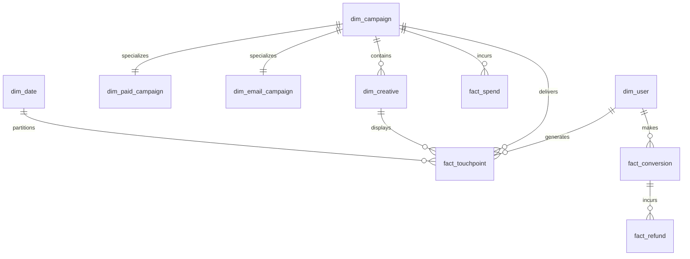

# Relational Schema Specification & Data Dictionary

## 1. Schema Mapping & Foreign Key Relationships

The Omnichannel Attribution Engine uses a hybrid architecture: an operational relational schema normalized to BCNF for core entities and an analytical **Star Schema** for high-performance marketing attribution rollups.

---

## 2. Table Specifications & Constraints

### 2.1 Dimension: `dim_user`
*Stores unique consumer profile information.*
- `user_id` (UUID, Primary Key): Unique surrogate identifier.
- `email` (VARCHAR(255), Unique, Not Null): User email address.
- `country` (VARCHAR(3), Not Null): ISO 3166-1 alpha-3 country code (`CHECK (char_length(country) = 3)`).
- `device_preference` (VARCHAR(20), Not Null): Primary device (`CHECK (device_preference IN ('MOBILE', 'DESKTOP', 'TABLET'))`).
- `first_seen_ts` (TIMESTAMPTZ, Not Null): Timestamp of initial user discovery.

### 2.2 Dimension: `dim_campaign` (Superclass)
*Abstract campaign configuration.*
- `campaign_id` (UUID, Primary Key): Unique campaign identifier.
- `name` (VARCHAR(150), Unique, Not Null): Marketing campaign title.
- `channel` (VARCHAR(30), Not Null): Platform channel (`CHECK (channel IN ('Google', 'Meta', 'TikTok', 'Email'))`).
- `is_active` (BOOLEAN, Not Null): Active status flag.
- `created_at` (TIMESTAMPTZ, Not Null): Record creation timestamp.

### 2.3 Subclass: `dim_paid_campaign` (EER Specialization)
*Specialized attributes for paid advertising.*
- `campaign_id` (UUID, Primary Key, Foreign Key $\to$ `dim_campaign(campaign_id)` ON DELETE CASCADE).
- `cpc_bid` (NUMERIC(8,4), Not Null): Cost per click target (`CHECK (cpc_bid >= 0)`).
- `target_network` (VARCHAR(50), Not Null): Distribution network (e.g., Search, Display, Reels).
- `daily_budget` (NUMERIC(10,2), Not Null): Daily budget ceiling (`CHECK (daily_budget >= 0)`).

### 2.4 Subclass: `dim_email_campaign` (EER Specialization)
*Specialized attributes for email marketing.*
- `campaign_id` (UUID, Primary Key, Foreign Key $\to$ `dim_campaign(campaign_id)` ON DELETE CASCADE).
- `sender_domain` (VARCHAR(100), Not Null): Verified sending domain.
- `template_id` (VARCHAR(50), Not Null): Email layout template identifier.
- `audience_segment` (VARCHAR(50), Not Null): Target cohort name.

### 2.5 Dimension: `dim_creative`
*Ad creative assets with Full-Text Search and Vector Embeddings.*
- `creative_id` (UUID, Primary Key): Surrogate identifier.
- `campaign_id` (UUID, Foreign Key $\to$ `dim_campaign(campaign_id)` ON DELETE CASCADE).
- `headline` (VARCHAR(255), Not Null): Marketing headline.
- `body_text` (TEXT): Expanded copy.
- `call_to_action` (VARCHAR(50), Not Null): CTA button text.
- `headline_tsv` (TSVECTOR, GENERATED ALWAYS): Pre-computed search vectors for FTS.
- `embedding` (vector(384)): 384-dimensional dense semantic embedding vector.
- `uq_creative_campaign` (UNIQUE (creative_id, campaign_id)): Enforces composite reference integrity.

### 2.6 Dimension: `dim_date`
*Consciously denormalized date dimension table.*
- `date_key` (INT, Primary Key): Date in YYYYMMDD format.
- `full_date` (DATE, Unique, Not Null): Calendar date.
- `day_of_week` (INT, Not Null, 1-7).
- `day_name`, `month_name` (VARCHAR(10), Not Null).
- `month_number` (INT, 1-12).
- `quarter` (INT, 1-4).
- `year` (INT, Not Null).
- `is_weekend` (BOOLEAN, Not Null).

### 2.7 Fact: `fact_touchpoint`
*Digital touchpoint interactions.*
- `touchpoint_id` (UUID, Primary Key).
- `user_id` (UUID, Foreign Key $\to$ `dim_user(user_id)` ON DELETE CASCADE).
- `campaign_id`, `creative_id` (UUID, Composite FK $\to$ `dim_creative(creative_id, campaign_id)`).
- `event_type` (VARCHAR(20), Not Null, `CHECK IN ('IMPRESSION', 'CLICK')`).
- `cost` (NUMERIC(10,4), Not Null, `CHECK (cost >= 0)`).
- `touchpoint_ts` (TIMESTAMPTZ, Not Null).
- `touchpoint_date` (DATE, GENERATED ALWAYS).
- `uq_user_event_time` (UNIQUE(user_id, campaign_id, touchpoint_ts)): Idempotent ingestion guarantee.

### 2.8 Fact: `fact_conversion`
*Completed checkout orders.*
- `conversion_id` (UUID, Primary Key).
- `user_id` (UUID, Foreign Key $\to$ `dim_user(user_id)` ON DELETE CASCADE).
- `order_id` (VARCHAR(100), Unique, Not Null).
- `gross_revenue` (NUMERIC(12,2), Not Null, `CHECK > 0`).
- `net_revenue` (NUMERIC(12,2), Not Null, `CHECK >= 0`).
- `currency` (VARCHAR(3), Default 'USD').
- `conversion_ts` (TIMESTAMPTZ, Not Null).
- `lookback_window_days` (INT, Default 30).
- `chk_net_lte_gross` (`CHECK (net_revenue <= gross_revenue)`).

### 2.9 Fact: `fact_refund`
*Post-conversion returns and adjustments.*
- `refund_id` (UUID, Primary Key).
- `conversion_id` (UUID, Foreign Key $\to$ `fact_conversion(conversion_id)` ON DELETE RESTRICT).
- `refund_amount` (NUMERIC(12,2), Not Null, `CHECK > 0`).
- `refund_ts` (TIMESTAMPTZ, Default CURRENT_TIMESTAMP).

### 2.10 Fact: `fact_spend`
*Aggregated daily marketing expenditure per campaign.*
- `spend_id` (UUID, Primary Key).
- `campaign_id` (UUID, Foreign Key $\to$ `dim_campaign(campaign_id)` ON DELETE CASCADE).
- `spend_date` (DATE, Not Null).
- `amount` (NUMERIC(12,2), Not Null, `CHECK >= 0`).
- `uq_campaign_spend_date` (UNIQUE (campaign_id, spend_date)).

### 2.11 Audit: `audit_log`
*System compliance and change tracking.*
- `log_id` (BIGSERIAL, Primary Key).
- `table_name` (VARCHAR(50), Not Null).
- `operation` (VARCHAR(10), `CHECK IN ('INSERT', 'UPDATE', 'DELETE')`).
- `record_id` (VARCHAR(100), Not Null).
- `old_data`, `new_data` (JSONB).
- `performed_by` (VARCHAR(50), Default CURRENT_USER).
- `logged_at` (TIMESTAMPTZ, Default CURRENT_TIMESTAMP).
