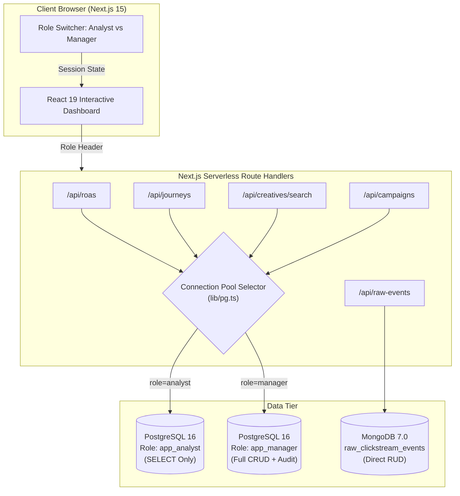

# Web Application & Database-Enforced RBAC (Unit 4)

This dossier details the full-stack architecture, API integration, and database-level security protocols implemented in the **Next.js 15 Web Application**, fulfilling **Rubric Components 10, 11, and 12 (9 Marks Total)**.

---

## 1. System Architecture



---

## 2. Database-Enforced Role-Based Access Control (Rubric Item 12 — 4 Marks)

Most web applications enforce roles exclusively in software (e.g., `if (user.role !== 'admin') throw 403`). If an attacker bypasses the API route, the underlying database connection possesses superuser privileges.

In this project, **authorization is strictly enforced by PostgreSQL itself**:

```sql
-- Analyst: Granted read-only access to views and dimensions
GRANT USAGE ON SCHEMA public TO app_analyst;
GRANT SELECT ON ALL TABLES IN SCHEMA public TO app_analyst;

-- Manager: Granted operational write access
GRANT SELECT, INSERT, UPDATE, DELETE ON ALL TABLES IN SCHEMA public TO app_manager;
GRANT USAGE, SELECT ON ALL SEQUENCES IN SCHEMA public TO app_manager;
```

### 2.1 The Two Database Roles

| Database Role | Privileges in PostgreSQL | Allowed Operations in Web UI | Expected PostgreSQL Behavior on Unauthorized Write |
|---|---|---|---|
| **`app_analyst`** | `SELECT` only on tables/views | Query ROAS, explore journey paths, perform vector searches. | **SQLSTATE 42501:** `permission denied for table dim_campaign` (HTTP 403) |
| **`app_manager`** | `SELECT, INSERT, UPDATE, DELETE` | Create campaigns, edit daily budgets, trigger spend adjustments. | **Success (200 OK):** Mutation approved; `trg_audit_campaign_budget` logs change to `audit_log`. |

---

## 3. Application Interfaces (Rubric Item 10 — 3 Marks)

The Next.js application exposes five responsive interfaces:

1. **Attribution & ROAS Dashboard (`/`):**
   - Live multi-model comparison across **First-Touch**, **Last-Touch**, **Linear**, and **Time-Decay** models.
   - Interactive model toggle updating attributed net revenues in real-time.
   - Explanatory panel illustrating how the AI Search shift impacts Google vs Meta ROAS.
2. **Customer Journey Explorer (`/journeys`):**
   - Reconstructs chronological multi-hop paths directly from the **Recursive CTE** (`view_customer_journey_paths`).
   - Breadcrumb step visualizations with journey frequencies and average interaction depths.
3. **Semantic Ad Creative Intelligence (`/creatives`):**
   - Natural language search query box connected to **PostgreSQL `pgvector`**.
   - Calculates real-time cosine similarity percentages ($1 - \text{Cosine Distance}$).
4. **MongoDB Raw Event Manager (`/raw-events`):**
   - Fulfills **Rubric Item 9 (7 Marks)** with interactive UI buttons:
     - **Read:** Filter by ad platform.
     - **Update:** Inline status mutation and fraud scoring in MongoDB.
     - **Delete:** Targeted deletion of quarantined bot documents.
5. **Campaign Administration & RBAC Demo (`/campaigns`):**
   - Live sandbox proving database role enforcement: attempts to execute `INSERT` as `app_analyst` vs `app_manager` with immediate feedback.

---

## 4. API & Database Integration (Rubric Item 11 — 2 Marks)

All backend endpoints use parameterized queries to prevent SQL injection vulnerabilities:

```typescript
// Sample Parameterized Query from /api/campaigns
await query(
  `INSERT INTO dim_campaign (name, channel, is_active) VALUES ($1, $2, TRUE);`,
  [name, channel],
  role // dynamically passes 'analyst' or 'manager' pool
);
```
